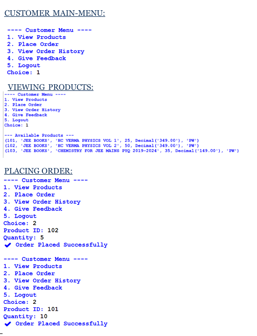
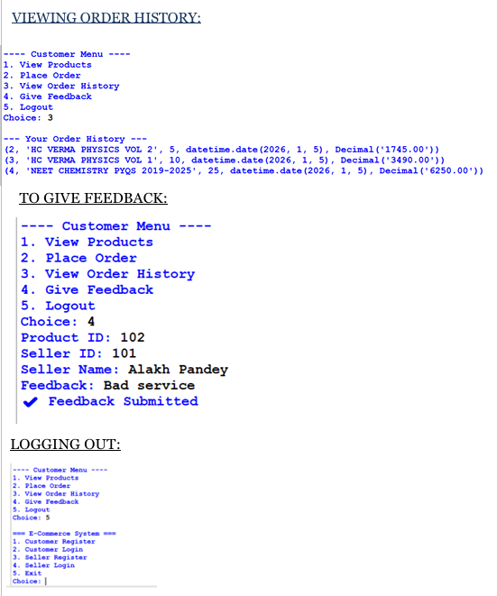
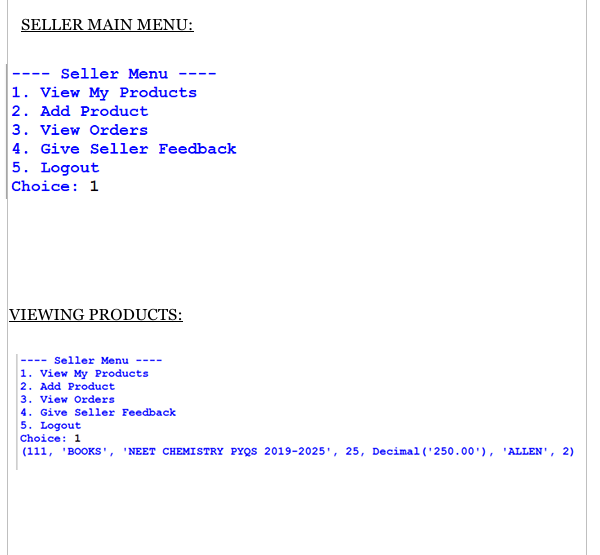
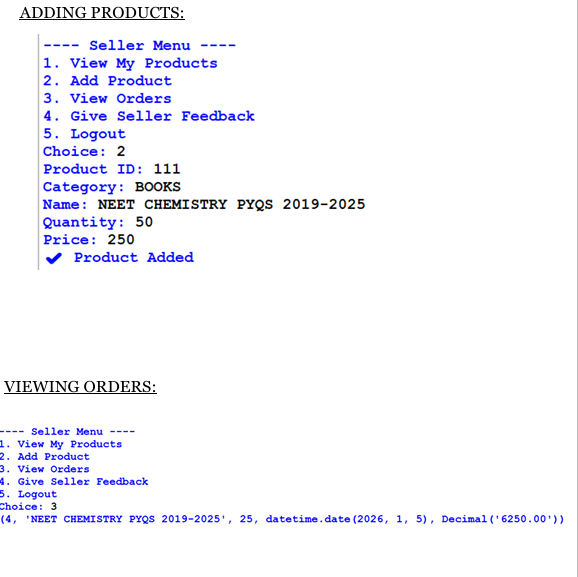

# Shopping System — Python & MySQL

A console-based e-commerce management system built with Python and MySQL. Originally developed as a **Class 12 CBSE Computer Science academic project**, it is now being further improved as part of my ongoing B.Tech learning journey.

The goal is to strengthen the original application through better authentication, database management, input validation, and more reliable operations.

## Features

### Customer
- Customer registration and login
- Browse available products
- Place orders
- View order history
- Submit feedback

### Seller
- Seller registration and login
- Add and manage products
- View received orders
- Submit feedback

### Security and Database Improvements
- Password hashing using bcrypt
- Verification of hashed passwords during login
- Support for migrating legacy plaintext passwords during successful login
- Username uniqueness checks
- Input validation for registration
- Automatic ID generation using MySQL `AUTO_INCREMENT`
- Database transactions and stock validation during order placement

## Technologies Used

- Python 3.x
- MySQL
- MySQL Connector for Python
- bcrypt

## Requirements

- Python 3.x
- MySQL Server
- MySQL Connector for Python
- bcrypt Python package

## Installation and Setup

1. Clone or download this repository.
2. Install Python 3.x and MySQL Server.
3. Install the required Python packages:

   ```bash
   pip install mysql-connector-python bcrypt
   ```

4. Create the required MySQL database and tables using the project's database schema.
5. Configure the database connection details in the application as required.
6. Open the project folder in VS Code or another Python IDE.
7. Run the application:

   ```bash
   python "shopping system.py"
   ```

8. Enter the appropriate MySQL credentials when prompted.

**Note:** The database schema file must be available in the repository for a fresh setup. Do not upload personal database backups, passwords, or other secrets.

## Project Structure

```text
Shopping-System-Python/
├── shopping system.py
├── README.md
└── screenshot/
    ├── customer_shopping_flow.png
    ├── customer_orders_feedback.png
    ├── seller_products.png
    └── seller_orders_management.png
```

*The structure above represents the main application files and screenshots. Additional files may be included as the project evolves.*

## Screenshots

### Customer Shopping Flow



### Customer Orders and Feedback



### Seller Products



### Seller Orders Management



## Project Evolution

- **Original project:** Developed as a Class 12 CBSE Computer Science academic project.
- **Current development:** Improving the existing application while learning and applying software development practices during B.Tech.
- **Focus areas:** Authentication security, database integrity, input validation, and reliable order processing.

## Future Improvements

- Graphical user interface using Tkinter
- Improved product search and filtering
- Admin dashboard
- Email verification and password reset
- Online payment integration
- Enhanced inventory management
- User profile management
- Automated testing and improved error handling

## Author

**Yatharth Jindal**

## Project Type

Educational project — originally developed for Class 12 CBSE Computer Science and currently being enhanced as a continuing learning project.

## License

Created for educational and learning purposes. No formal open-source license has been specified.
